# Mental foramen and inferior alveolar canal segmentation on panoramic radiographs

Before implant surgery in the lower premolar region, the surgeon has to avoid the mental foramen (the nerve exit)
and the inferior alveolar canal. This project finds both automatically on dental panoramic radiographs, reports which
tooth the foramen lies beneath, and refers cases it cannot answer reliably to a clinician. It is done in collaboration
with dentists at Linkou Chang Gung Memorial Hospital.

The radiographs and annotations are clinical data and are **not** included. This repository holds the code only.

## Contents

The sections follow the research flow:

1. [Pipeline](#1-pipeline): the two-stage chain from radiograph to tooth position or referral
2. [Data and evaluation](#2-data-and-evaluation): dataset, splits, hit-rate definition
3. [Segmentation model: U-Net against YOLO-seg](#3-segmentation-model-u-net-against-yolo-seg): main results, hit-threshold sensitivity, visibility
4. [Design choices](#4-design-choices): ablation, learning curve, preprocessing, image-quality fixes
5. [Uncertainty and referral](#5-uncertainty-and-referral): ensemble disagreement as a referral score
6. [Tooth position](#6-tooth-position): Tebo & Telford rule, missing-tooth and numbering flags, system-level referral
7. [Deployment](#7-deployment): INT8 cascade, latency, compute against accuracy, robustness, laptop timing
8. [Hardware](#8-hardware): rooflines, accelerator model, low-bit and 2:4 sparsity, fixed point

Reference: [Main scripts](#main-scripts) · [Layout](#layout) · [Credits](#credits)

## 1. Pipeline


```
panoramic radiograph
 └─ stage 1: YOLOv8s-seg tooth instance segmentation (imgsz 1024)                 stage1/fdi_cropped.py
     └─ filtering → upper / lower jaw split (k-means) → FDI tooth numbering
         └─ left and right ROI around teeth 34–36 / 44–46, down to the mandible's lower border
             └─ unsharp mask                                                        data/mf_unsharp_mask.py
                 └─ stage 2: segment the mental foramen (mf) and the canal (ian)
                     ├─ U-Net with a ResNet34 encoder, 512 × 512                   stage2/kfold_unet_variants.py
                     └─ YOLO-seg (v8 / 11 / 26, n / s, imgsz 1280)
                         └─ keep the largest foramen region (lcc)                  stage2/mf_postproc.py
                             └─ foramen centroid, hit rate, tooth position (Tebo & Telford)  position/mf_position.py
                                 └─ referral: numbering flags, boundary margin      position/position_referral.py
```

The deployed version of the whole chain is one script, `deployment/deploy_pipeline.py` ([section 7](#7-deployment)).

<sub>[↑ Contents](#contents)</sub>

## 2. Data and evaluation

559 ROIs cropped from at least 294 panoramic radiographs, 5-fold cross-validation grouped by patient and source
radiograph (`stage2/kfold_pano.py`), plus an independent test set of 137 ROIs. A foramen counts as found ("hit") when the
predicted centroid lies within the ground-truth foramen's equivalent radius. Unless stated otherwise: five training seeds,
the test set scored with a five-fold pixel-wise majority vote, keeping only the largest connected foramen region (lcc).

A manual review found 8 same-patient pairs (different visits) across cross-validation folds and none between the test set
and training. Excluding them keeps the U-Net lead below at +3.2 to +3.5 points (p ≤ 0.0004; `data/find_same_patient_cv.py`).

Stage 1 has no tooth-level ground truth on the patient test set, so it is checked at the level of the pipeline: the automatic
crop contains the annotated foramen in 137 of 137 test ROIs (95% CI 97.3–100%) and produces an ROI for 204 of 206 sides of
the test radiographs. Over all 851 radiographs, without the selection of the test set, 10.0% of sides get no ROI, mostly
with many missing teeth (`stage1/stage1_eval.py`, `stage1/stage1_failures.py`).

<sub>[↑ Contents](#contents)</sub>

## 3. Segmentation model: U-Net against YOLO-seg

| Model | Test hit rate | Test mf Dice | Test ian Dice |
| --- | --- | --- | --- |
| U-Net (ResNet34) | 93.0 ± 0.8% | 0.712 | 0.683 |
| YOLO26s-seg (best of six YOLO models) | 87.7 ± 1.7% | 0.707 | 0.685 |

All seven models with seed 0 (five-fold cross-validation and the test-set five-fold vote, lcc). YOLO26s was chosen for
the five-seed comparison above before the other seeds were run:

| Model (seed 0) | CV hit rate | CV mf Dice | CV ian Dice | Test hit rate | Test mf Dice | Test ian Dice |
| --- | --- | --- | --- | --- | --- | --- |
| U-Net (ResNet34) | **87.1%** | **0.715** | 0.642 | **94.2%** | **0.720** | 0.680 |
| YOLOv8n-seg | 81.6% | 0.676 | 0.577 | 85.4% | 0.676 | 0.640 |
| YOLOv8s-seg | 78.2% | 0.663 | 0.598 | 85.4% | 0.664 | 0.645 |
| YOLO11n-seg | 82.3% | 0.691 | 0.614 | 84.7% | 0.699 | 0.657 |
| YOLO11s-seg | 83.0% | 0.700 | 0.613 | 87.6% | 0.719 | 0.665 |
| YOLO26n-seg | 82.5% | 0.697 | 0.637 | 86.1% | 0.700 | **0.685** |
| YOLO26s-seg | 82.5% | 0.695 | **0.647** | 89.8% | 0.714 | 0.682 |

- With the five seeds pooled and a patient-level bootstrap, the U-Net finds more foramina: +5.3 points on the test
  set (95% CI 2.4–8.5, p = 0.0005) and +3.8 points in cross-validation (95% CI 2.1–5.6, p < 0.001). Dice is not
  significantly different (`analysis/pano_stats.py`, `analysis/seed_bootstrap.py`).
- The gap holds at hit thresholds of 1–2 radii, but not at 0.5 radii on the test set (+2.9 points, p = 0.21), and the
  median localization error is no better than YOLO26s. The U-Net wins by making fewer large errors, not by being more
  precise (`analysis/hit_threshold.py`).


- Accuracy is limited by how visible the foramen is: on images graded as visible, Dice reaches 0.84, above the
  annotator's own repeat agreement (0.79), and only 4 of the 236 visible cross-validation ROIs are missed
  (`analysis/pano_visibility.py`, `stage2/visible_headroom.py`). The U-Net's lead over YOLO26s lies in the images graded
  as not visible (cross-validation, U-Net five seeds against YOLO26s seed 0: 78.3% against 71.8%; visible: 98.2% against 97.0%).


<sub>[↑ Contents](#contents)</sub>

## 4. Design choices

The ablation, learning curve and preprocessing comparison were first run on an earlier patient-level split with one seed. They were re-run on the
current split with three to five seeds and lcc (`stage2/kfold_pano.py --unet-config / --train-frac / --variant`), so they compare directly with the table above.

- Strong augmentation matters most: without it the cross-validation hit rate drops 2.3 points (95% CI 0.9–3.7, p = 0.001) and both
  Dice scores drop. ImageNet pretraining leaves the hit rate unchanged (p = 0.83) but raises the canal Dice by about 0.02.


- The hit rate levels off at about 75% of the training data (75% to 100%: +0.1 points in cross-validation, p = 0.91).


- A larger ResNet50 encoder does not help (seed 0, cross-validation against ResNet34: hit rate −0.9 points, 95% CI −2.9
  to +1.1; mf Dice −0.019, p = 0.013; ian Dice −0.016, p = 0.001), so ResNet34 is kept.
- CLAHE does not beat the light unsharp mask.


- Low image quality is the main source of misses, but none of the fixes tried helped on the original data: histogram
  matching, z-score, gamma test-time augmentation and other region choices at inference; quality augmentation and
  oversampling the harder batch in training (the test hit rate dropped about 3 points). A separately trained visibility
  classifier does not flag misses better than the ensemble's own disagreement, and a classical detector (scale-normalized
  dark-blob response plus a position prior, no neural network) finds 52–66% of foramina against the U-Net's 88–93%
  (`stage2/quality_errors.py`, `stage2/quality_methods.py`, `stage2/quality_train_eval.py`, `stage2/quality_gate.py`).

<sub>[↑ Contents](#contents)</sub>

## 5. Uncertainty and referral

Disagreement among models trained with different seeds flags uncertain cases without labels: referring the 10%
most uncertain ROIs to a clinician raises the hit rate on the rest from 87.8% to 94.0% in cross-validation (gain
95% CI 4.6–8.2 points) and from 92.7% to 97.6% on the test set (gain 95% CI 1.4–7.8 points; five seeds pooled into one
vote) (`analysis/pano_uncertainty.py`, `analysis/uncertainty_ci.py`).


<sub>[↑ Contents](#contents)</sub>

## 6. Tooth position

Tooth position follows Tebo & Telford: which tooth the foramen lies beneath, judged from tooth-axis lines drawn by stage 1
(one annotator, test set).

- 103 of 132 foramina have normal dentition. On those, the full pipeline (stage-1 ROI, U-Net, lcc, tooth-axis rule) gives
  the annotator's answer for 90.8 ± 0.5% over five seeds (seed 0: 92 / 102 = 90.2%, 95% CI 83.8–96.0, bootstrap by radiograph),
  and automatically cropped ROIs give the same answers as manual ones. The rule alone on the ground-truth foramen agrees on
  98 / 103; the 5 disagreements lie just past the rule's boundary and were relabeled after review (rule 103 / 103, pipeline
  95.7%), which is reported separately because the review came after seeing the rule (`position/position_report.py`,
  `position/position_seeds.py`).
- The U-Net's lead over YOLO26s carries over to tooth position: +3.3 points (95% CI 0.4–6.6). The quantized, fixed-point
  and smaller models of sections 7–8 show no loss in tooth position (all CIs include 0).
- Missing teeth (21) and wrong FDI numbering (8), 22% of the foramina, have no valid answer. Two flags send a side to review:
  two tooth numberings (stage 1 and a 32-class tooth model) disagree on teeth x4–x6, or the side has fewer teeth than the
  other side (`position/fdi_flag.py`, `position/side_count_flag.py`). A third rule refers foramina whose centroid lies within
  0.138 half-widths of a decision boundary; the threshold is the 10th percentile on cross-validation predictions, set before
  looking at the test set (`position/position_referral.py`, `position/referral_combo.py`).
- Over all test sides, including abnormal ones, these rules cut silent errors (a wrong answer that is not referred) from
  27% to 6.4%, at the cost of referring 39% of sides (full decoder; 7.2% and 37.9% with the deployed slim decoder,
  section 7):


- What is left comes from stage 1, not from the foramen model. With the adjudicated labels every remaining silent error is
  an abnormal side the flags missed, and the largest share of unnecessary referrals is the two numberings disagreeing on a
  normal side (`deployment/bottleneck.py`, `position/flag_patterns.py`). Under synthetic image changes, stage 1 is far more
  sensitive than stage 2: 77% of the changed answers come from a tooth-axis line jumping to another tooth or disappearing
  after a tooth is detected or numbered differently. Re-running stage 1 on the mirrored radiograph and referring when the
  answers differ catches some of these, but adds 0.36 s and is left as an option (`stage1/stage1_lines_robust.py`,
  `stage1/stage1_flag_robust.py`, `deployment/deploy_pipeline.py --flip-flag`).
- Not adopted: correcting the predicted foramen's width or centroid (no systematic bias), and a midline rule between adjacent
  tooth axes, which needs a relabeled test set before it can be compared (`position/position_improve.py`, `position/midline_rule.py`).

<sub>[↑ Contents](#contents)</sub>

## 7. Deployment

`deployment/deploy_pipeline.py` runs the whole chain from a radiograph to a tooth position or a referral, and scores it
against the labels (`--score`) or times it (`--time`). The deployed configuration:

- stage 1 in FP32 at 1024 px, with masks upsampled only inside each tooth's box (bit-identical to the original, `deployment/fast_masks.py`);
- the 32-class tooth model in INT8 at 640 px, used only for the numbering flag;
- the U-Net with a slim decoder (decoder channels halved to 128 / 64 / 32 / 32, output head at half resolution, then
  upsampled; adopted on 18 Nov 2026) in OpenVINO INT8 (NNCF post-training quantization) as a cascade: run two folds,
  take their union if they agree (foramen IoU ≥ 0.5), otherwise run all five and vote; a direct three-class comparison
  replaces `argmax` (bit-identical);
- the three referral rules of section 6.

Five seeds on the test set: tooth position 91.6% (96.5% adjudicated), 37.9% of sides referred, 88.4% of the answered sides
correct, 7.2% silent errors. The foramen hit rate is about 1 point below the full-precision five-fold ensemble (−1.3,
95% CI −3.1 to +0.2), while tooth position does not change. Against the same pipeline with the full decoder, the slim
decoder changes tooth position by +1.4 points (95% CI −0.2 to +3.2), the foramen hit rate by −0.3 points and the foramen
Dice by −0.004 (both CIs include 0), and lowers the canal Dice by 0.010 (95% CI 0.004–0.017); it was adopted for the
speed below.


- Speed: about 0.67 s per radiograph on a laptop CPU (i5-13500H, 662–672 ms over four rounds alternating with the full
  decoder at 811 ms in the same session: −144 ms, 1.22× faster; p90 990 → 778 ms). With the full decoder, INT8 makes the
  U-Net 3.0× faster and the whole pipeline 2.3× faster, and the RTX 4050 takes about 0.2 s (the GPU version is scored the
  same as the CPU version, except a canal Dice 0.004–0.007 lower; it has no slim-decoder build yet). With the slim decoder,
  46% of the CPU time is stage 1 and 39% the U-Net, so stage 1 is now the larger share.
- What did not make it in: INT8 for stage 1 costs 2–4.5 points of tooth position, and mixed precision, accuracy-aware
  quantization and distillation QAT did not fix that without keeping most blocks in FP32 (`stage1/stage1_int8.py`);
  stage 1 below 1024 px fails the same check (`stage1/stage_imgsz.py`); 2:4 sparse weights are not faster on the CPU
  (`hardware/sparse_cpu_bench.py`). A hybrid cascade that first runs two cheaper 384 px U-Nets matched the hit rate, Dice
  and tooth position over five seeds, but referred 1.5 points fewer sides with 0.6 points more silent errors and was only
  about 5% faster on the laptop (`--first-tag`, kept as an option); the slim decoder at 384 px lost 0.019 test foramen Dice
  (95% CI 0.005–0.036).
- Compute against accuracy: the cascade halves the compute of the five-fold ensemble at almost the same hit rate. Running
  25 models instead of 5 is no more accurate, so the ensemble is saturated (`analysis/policy_pareto.py`). A single
  ResNet18 U-Net at 384 px needs 1/12 of the ensemble's compute and finds 3.4 points fewer foramina (95% CI 1.0–5.9;
  `deployment/single_small_lcc.py`).


- Robustness: under synthetic changes the U-Net is most sensitive to noise (σ = 5 grey levels: −8.9 points). A 3×3 median
  filter recovers most of it without hurting clean images, and is kept as an option (`--pre median3`) because the data
  has no such noise (`analysis/robust_stress.py`, `analysis/robust_defense.py`). Retraining with noise augmentation
  (seed 0) also removes the weakness (σ = 5 / 10: +10 / +35 points against the current INT8 model) without changing the
  clean hit rate, but is not better than the median filter (+2.9 points, 95% CI −2.2 to +7.9) and has a 0.02 lower foramen
  Dice on clean images, so it was not adopted (`analysis/robust_noiseaug.py`).

- Measuring latency on a laptop: wall-clock times of the same configuration varied by about ±25% between sessions, while
  rounds within a session agreed to 1–4%. The main cause was Windows power throttling (EcoQoS): a process started from a
  background window is moved to efficiency scheduling after a few minutes, and the 12-thread stage-1 model slows from about
  210 to 330 ms while the 4-thread U-Net does not change. The pipeline and the timing scripts therefore opt out of power
  throttling at start-up (`deployment/no_throttle.py`; `--allow-throttle` keeps the old behaviour), which also matters if
  the pipeline runs as a background service. Thread placement across the P- and E-cores adds a smaller variation (2–3%);
  pinning threads or restricting them to the P-cores is 12–14% slower on average, so OpenVINO's defaults are kept. All
  comparisons above are made within one session (`deployment/cpu_timing/`).


<sub>[↑ Contents](#contents)</sub>

## 8. Hardware

Rooflines and an analytical accelerator model place the U-Net in the compute-bound region once layers are fused, so an
INT8 accelerator gains most from doing fewer MACs.



Measured per-layer roofline of the U-Net on an RTX 3090, and modeled latency across PE arrays and SRAM sizes:

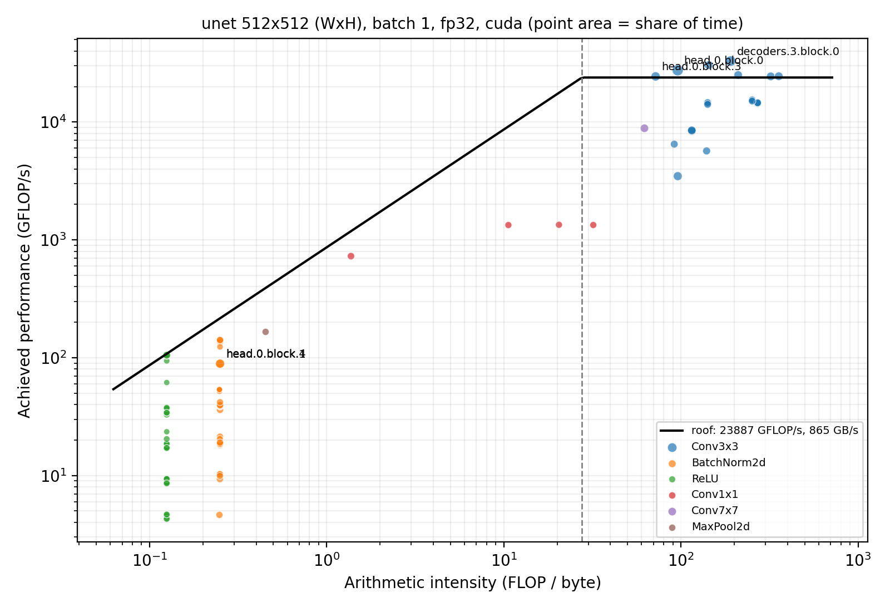

- Folding the 46 BatchNorm layers into the convolutions raises the U-Net's intensity from 59.9 to 83.5 FLOP/byte and cuts
  the share of layer time spent in memory-bound layers from 40% to 19%; end-to-end latency on the RTX 3090 drops only from
  5.9 to 5.7 ms (median, two alternating runs each), because the convolutions already dominate (`hardware/roofline_profile.py --fuse`).
- The deployed CPU runtime already fuses everything: OpenVINO folds BatchNorm, ReLU, the residual additions and the output
  quantization into each of the 47 convolutions, and convolutions take 92.6% of the INT8 time. Every block runs at about the
  same speed, so each block's share of time follows its share of multiply-accumulates; the high-resolution end of the decoder
  (decoder 3 and the head) takes about 30%. Further speed-ups must come from fewer MACs, not from fusion
  (`deployment/unet_perf_count.py`, `deployment/perf_count_layers.py`).


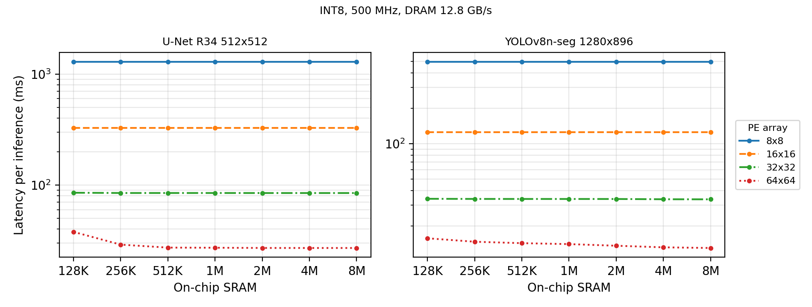

- In the analytical model, 4-bit weights or activations barely change latency at the same number of PEs (the array is
  compute-bound), while 2:4 structured sparsity roughly halves it. For the deployed configuration (slim decoder, INT8
  cascade with 2.58 models per ROI on average, skip and residual feature maps tracked layer by layer), a 64×64 array with
  1 MB of SRAM takes 45 / 27 / 19 ms per ROI for dense / 2:4 / 1:4 INT8 at 12.8 GB/s and 68 / 60 / 53 ms at 4 GB/s; INT8
  with 2:4 uses 0.19× the energy of the five-fold main model in INT8. These are first-order estimates without area or
  index-selection cost (`hardware/accel_lowbit.py`, `hardware/accel_deploy.py --tiling v2`, `hardware/skip_traffic.py`).
- Cross-check against Timeloop and Sparseloop on four layers, with pass criteria set before each run: the model's first
  tiling never underestimated DRAM traffic, but it overestimated a layer whose weights nearly fill the SRAM by 82%. The
  corrected tiling is within 0.93–0.99× of Timeloop's minimum traffic on all four layers, also with the array held at full
  speed. For 2:4, weight traffic agrees within 3% and the cycle ratio (0.50) matches on two of three layers; on the third
  the model rounds 4.5 passes of the array up to 5, as the hardware has to. Energy constants are not checked externally
  (`hardware/timeloop_check.py`, `hardware/timeloop_followup.py`, `hardware/tiling_v2_check.py`).
- Accuracy, as cross-validation hit rate against a pre-set margin of about 1 point: 4-bit activations fail; 2:4 sparsity
  works once the 32→3 output layer stays dense, and stacks with INT8 over five seeds (`hardware/qat_int4.py`,
  `hardware/sparse24.py`). The accelerator candidate is INT8 with 2:4 sparsity on 45 of 47 convolutions.


- Fixed-point arithmetic for the RTL: a 16-bit requantization multiplier is enough; biases need 8 extra fractional bits in
  the accumulator, and residual additions should align both inputs and round once. With these the fixed-point model matches
  the integer model (five seeds: hit +0.04 points, mf Dice −0.0003; `hardware/fx_diag.py`, `hardware/fx_seeds.py`).

<sub>[↑ Contents](#contents)</sub>

## Main scripts

| Script | Purpose |
| --- | --- |
| `stage1/fdi_cropped.py` | Stage 1: tooth segmentation, filtering, FDI numbering, ROI cropping |
| `stage2/kfold_pano.py`, `data/find_same_patient_cv.py` | Stage 2 model comparison: grouped 5-fold split, U-Net and six YOLO models, evaluation; same-patient check across folds |
| `stage2/kfold_unet_variants.py` | U-Net model (`ResNetUNet`), configurations, training and inference |
| `analysis/paper_metrics.py` | Metrics: Dice, hit rate, cross-validation and test-set evaluation |
| `stage2/mf_postproc.py` | Keep the largest connected foramen region (lcc, standard pipeline) |
| `analysis/pano_stats.py`, `analysis/seed_bootstrap.py`, `analysis/hit_threshold.py` | Paired tests, patient-level bootstrap across seeds, hit-threshold sensitivity |
| `analysis/pano_visibility.py`, `analysis/pano_uncertainty.py`, `analysis/uncertainty_ci.py` | Visibility-stratified results; model disagreement as an uncertainty score, with confidence intervals |
| `stage2/quality_errors.py`, `stage2/quality_methods.py`, `stage2/quality_train_eval.py`, `stage2/quality_gate.py`, `stage2/visible_headroom.py` | Error analysis by image quality; inference- and training-side fixes, a visibility classifier and a classical detector (none adopted) |
| `stage1/stage1_eval.py`, `stage1/stage1_failures.py`, `analysis/e2e_eval.py`, `analysis/e2e_seeds.py` | Stage-1 validation and the end-to-end comparison with manual ROIs |
| `position/mf_position.py`, `position/mf_position_eval.py`, `position/position_server.py` | Tooth-position rule, its evaluation, and a browser labeling tool (also for abnormal-dentition and blind relabeling) |
| `position/mf_axis_v2.py` | Comparison of the current tooth-axis lines (each premolar's own root axis, the first molar's two root axes averaged) with the earlier version |
| `position/position_report.py`, `position/position_seeds.py`, `position/position_reports.py` | Tooth-position report with confidence intervals; five seeds and hardware variants; reports for the relabeling and review tools |
| `position/fdi_flag.py`, `position/side_count_flag.py`, `position/gap_flag.py`, `position/flag_patterns.py` | Flags for missing teeth or wrong FDI numbering: agreement of two numberings, left/right tooth count, inter-tooth gaps (gaps added nothing); flag patterns |
| `position/position_referral.py`, `position/referral_combo.py` | Referral over all sides: disagreement, boundary margin, mirrored-image flag |
| `position/cascade_position.py`, `position/position_improve.py`, `position/mf_position_sensitivity.py` | Tooth position with the cascade's outputs; centroid and width corrections; sensitivity near the rule's boundaries |
| `position/midline_rule.py`, `position/midline_teeth32.py`, `position/midline_overlays.py`, `position/midline_review_server.py` | Exploratory midline rule and its label-free checks |
| `stage1/stage1_lines_robust.py`, `stage1/lines_breakdown.py`, `stage1/stage1_flag_robust.py`, `stage1/flipflag_compare.py` | Stability of stage-1 tooth-axis lines under image changes; mirrored-image flag |
| `stage1/stage1_int8.py`, `stage1/stage_imgsz.py`, `stage1/yolo_int8_export.py`, `stage1/stage1_split.py` | INT8 and lower resolution for the tooth models; stage-1 time breakdown |
| `stage1/teeth32_adapt.py` | Self-training of the 32-class tooth model on unlabeled radiographs |
| `deployment/deploy_pipeline.py`, `deployment/fast_masks.py`, `deployment/score_from_csv.py` | Deployed pipeline: scoring, timing, CPU (OpenVINO) and GPU (PyTorch) versions |
| `deployment/bottleneck.py`, `deployment/unet_call_split.py`, `deployment/unet_int8_bench.py`, `deployment/pipeline_timing.py` | Where accuracy and time are lost; U-Net call breakdown; INT8 against FP32 |
| `deployment/int8_quant.py`, `deployment/int8_ensemble.py`, `deployment/cascade_infer.py`, `deployment/single_small_lcc.py`, `deployment/distill_ensemble.py` | INT8 quantization, the cascade, a small single model, ensemble distillation |
| `deployment/unet_perf_count.py`, `deployment/perf_count_layers.py` | OpenVINO per-node CPU profile of the U-Net (fusion check) and its mapping back to layers, MACs and INT8 / FP32 speed |
| `deployment/no_throttle.py`, `deployment/timing_env.py`, `deployment/cpu_timing/` | Opting out of Windows power throttling; logging memory, page file and power mode around each timing run; sustained-load, core-scheduling and background-throttling benchmarks for laptop latency (PowerShell + Python) |
| `analysis/policy_pareto.py`, `analysis/robust_stress.py`, `analysis/robust_remedy.py`, `analysis/robust_defense.py`, `analysis/robust_noiseaug.py` | Compute against accuracy; synthetic stress tests, inference-time defenses and noise-augmented retraining |
| `hardware/roofline_profile.py`, `hardware/roofline_workload.py`, `hardware/accel_model.py`, `hardware/accel_explore.py`, `hardware/accel_lowbit.py` | Rooflines, workload characterization and the analytical accelerator model, including bit width and 2:4 sparsity |
| `hardware/accel_deploy.py`, `hardware/skip_traffic.py` | The accelerator model on the deployed configuration, with skip and residual feature maps tracked per layer |
| `hardware/timeloop_check.py`, `hardware/timeloop_followup.py`, `hardware/tiling_v2_check.py` | Cross-check of the accelerator model against Timeloop and Sparseloop (dense, full-speed and 2:4), and of the corrected tiling |
| `hardware/qat_fx.py`, `hardware/qat_int4.py`, `hardware/sparse24.py`, `hardware/sparse_int8_verify.py`, `hardware/fx_diag.py`, `hardware/fx_seeds.py` | Quantization-aware training (INT8, 4-bit), 2:4 sparsity, integer and fixed-point verification |
| `stage2/unet_tta.py`, `stage2/pseudo_label.py`, `stage2/kfold_pseudo.py` | Flip test-time augmentation and semi-supervised training, neither adopted |
| `analysis/unlabeled_pool.py`, `analysis/unlabeled_predict.py`, `analysis/unlabeled_shift.py` | Distribution check on unlabeled ROIs |
| `stage1/fdi_tufts.py`, `stage1/tufts_teeth.py`, `stage1/teeth32_compare.py`, `analysis/tufts_eval.py`, `analysis/tufts_proxy.py`, `analysis/tufts_mf_eval.py` | Experiments on the external Tufts Dental Database; the data is not included |

## Layout

| Folder | Contents |
| --- | --- |
| `data/` | Dataset conversion, preprocessing, label and duplicate checks, the visibility grading tools |
| `stage1/` | Tooth segmentation, FDI numbering, ROI cropping, their evaluation and robustness |
| `stage2/` | Mental foramen and canal segmentation: splits, training, inference, post-processing, error analysis |
| `position/` | Tooth-position rule, flags, referral, their evaluation and the labeling tools |
| `analysis/` | Metrics, statistics, stratified analyses, stress tests and the results workbook |
| `deployment/` | The deployed pipeline, quantization, cascade, latency and CPU-timing tools |
| `hardware/` | Rooflines, the accelerator model, low-bit and sparse training, fixed-point verification |
| `docs/` | `make_figures.py` and the figures; figures hold aggregate results and diagrams only, with no radiographs or annotations |

Run scripts as modules from the repository root, for example `python -m stage2.kfold_pano`. Data paths point to a
`datasets/` folder that is not part of this repository. Scripts from earlier stages are kept when they back a reported result.

Environment: Python 3.10, PyTorch 2.9, Ultralytics 8.4, OpenVINO 2026.4 with NNCF.

## Credits

Research with the Biomedical/Multimedia IC and System Design Lab, Chung Yuan Christian University (advisor:
Prof. Shih-Lun Chen), and dentists at Linkou Chang Gung Memorial Hospital. Many of the evaluation, statistics and
performance-analysis scripts were written with the help of an AI assistant (Claude).
