# Mental foramen and inferior alveolar canal segmentation on panoramic radiographs

Before implant surgery in the lower premolar region, the surgeon has to avoid the mental foramen (the nerve exit)
and the inferior alveolar canal. This project finds both automatically on dental panoramic radiographs, in
collaboration with dentists at Linkou Chang Gung Memorial Hospital.

The radiographs and annotations are clinical data and are **not** included. This repository holds the code only.

## Pipeline


```
panoramic radiograph
 └─ stage 1: YOLOv8s-seg tooth instance segmentation (imgsz 1024)                 stage1/fdi_cropped.py
     └─ filtering → upper / lower jaw split (k-means) → FDI tooth numbering
         └─ left and right ROI around teeth 34–36 / 44–46, down to the mandible's lower border
             └─ unsharp mask                                                        data/mf_unsharp_mask.py
                 └─ stage 2: segment the mental foramen (mf) and the canal (ian)
                     ├─ U-Net with a ResNet34 encoder, 512 × 512                   stage2/kfold_unet_variants.py
                     └─ YOLO-seg (v8 / 11 / 26, n / s, imgsz 1280)
                         └─ keep the largest foramen region (lcc)                  stage2/mf_postproc.py
                             └─ foramen centroid, hit rate, tooth position (Tebo & Telford)  position/mf_position.py
```

## Results

559 ROIs cropped from at least 294 panoramic radiographs, 5-fold cross-validation grouped by patient and source
radiograph (`stage2/kfold_pano.py`), plus an independent test set of 137 ROIs. A foramen counts as found ("hit") when the
predicted centroid lies within the ground-truth foramen's equivalent radius. Five training seeds, test set with a
five-fold pixel-wise majority vote, keeping only the largest connected foramen region (lcc):

| Model | Test hit rate | Test mf Dice | Test ian Dice |
| --- | --- | --- | --- |
| U-Net (ResNet34) | 93.0 ± 0.8% | 0.712 | 0.683 |
| YOLO26s-seg (best of six YOLO models) | 87.7 ± 1.7% | 0.707 | 0.685 |

- With the five seeds pooled and a patient-level bootstrap, the U-Net finds more foramina: +5.3 points on the test
  set (95% CI 2.4–8.5, p = 0.0005) and +3.8 points in cross-validation (95% CI 2.1–5.6, p < 0.001). Dice is not
  significantly different (`analysis/pano_stats.py`, `analysis/seed_bootstrap.py`).
- The gap holds at hit thresholds of 1–2 radii, but not at 0.5 radii on the test set (+2.9 points, p = 0.21), and the
  median localization error is no better than YOLO26s. The U-Net wins by making fewer large errors, not by being more
  precise (`analysis/hit_threshold.py`).
- Accuracy is limited by how visible the foramen is: on images graded as visible, Dice reaches 0.84, above the
  annotator's own repeat agreement (0.79) (`analysis/pano_visibility.py`).
- Disagreement among models trained with different seeds flags uncertain cases without labels: referring the 10%
  most uncertain ROIs to a clinician raises the hit rate on the rest from 87.8% to 94.0% in cross-validation (gain
  95% CI 4.6–8.2 points) and from 92.7% to 97.6% on the test set (gain 95% CI 1.4–7.8 points; five seeds pooled into one
  vote) (`analysis/pano_uncertainty.py`, `analysis/uncertainty_ci.py`).
- Deployment: per-layer rooflines and end-to-end latency (0.15 s per radiograph on a GPU, 0.4–1.1 s without one;
  `deployment/roofline_profile.py`, `deployment/pipeline_timing.py`), INT8 quantization with OpenVINO NNCF (2.5–3× faster on a CPU;
  `deployment/int8_quant.py`, `deployment/int8_ensemble.py`), and a cascade that stops after two folds when they agree (49% less compute,
  92.9% vs 93.0% hit rate; `deployment/cascade_infer.py`). A single ResNet18 U-Net at 384 px needs 1/12 of the ensemble's compute and
  finds 89.6 ± 0.6% of foramina, 3.4 points fewer (95% CI 1.0–5.9, p = 0.010; `deployment/single_small_lcc.py`).

## Figures

Figures hold aggregate results and diagrams only, with no radiographs or annotations. `docs/make_figures.py` regenerates them.

### Current results

New split, five seeds, lcc.




### Earlier experiments

These ran on the earlier patient-level split with one seed, so their values are not comparable with the table above. The conclusions are what carry over.




### Hardware analysis



Measured per-layer roofline of the U-Net on an RTX 3090, and modeled latency across PE arrays and SRAM sizes:

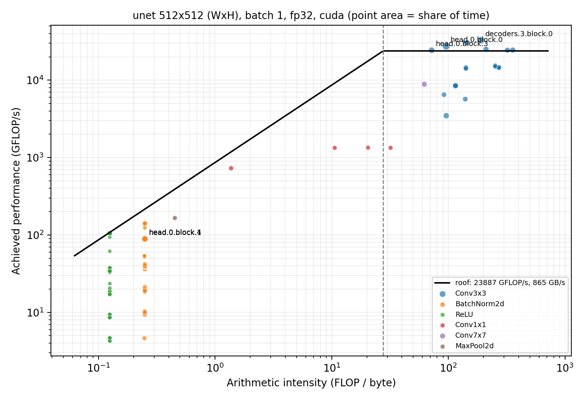

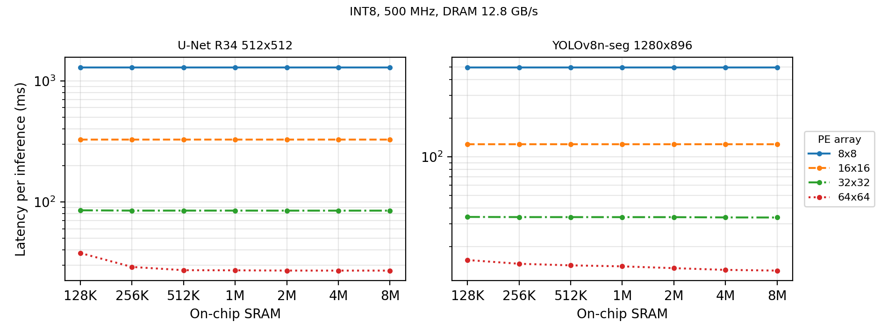

## Main scripts

| Script | Purpose |
| --- | --- |
| `stage1/fdi_cropped.py` | Stage 1: tooth segmentation, filtering, FDI numbering, ROI cropping |
| `stage2/kfold_pano.py`, `data/find_same_patient_cv.py` | Stage 2 model comparison: grouped 5-fold split, U-Net and six YOLO models, evaluation; same-patient check across folds |
| `stage2/kfold_unet_variants.py` | U-Net model (`ResNetUNet`), configurations, training and inference |
| `analysis/paper_metrics.py` | Metrics: Dice, hit rate, cross-validation and test-set evaluation |
| `stage2/mf_postproc.py` | Keep the largest connected foramen region (lcc, standard pipeline) |
| `analysis/pano_stats.py`, `analysis/seed_bootstrap.py`, `analysis/hit_threshold.py` | Paired tests, patient-level bootstrap across seeds, hit-threshold sensitivity |
| `analysis/pano_visibility.py`, `analysis/pano_uncertainty.py`, `analysis/uncertainty_ci.py` | Visibility-stratified results; model disagreement as an uncertainty score, with confidence intervals |
| `stage1/stage1_eval.py`, `stage1/stage1_failures.py`, `analysis/e2e_eval.py` | Stage-1 validation and the end-to-end comparison with manual ROIs |
| `position/mf_position.py`, `position/mf_position_eval.py`, `position/position_server.py` | Tooth-position rule, its evaluation, and a browser labeling tool |
| `deployment/roofline_profile.py`, `deployment/pipeline_timing.py`, `deployment/int8_quant.py`, `deployment/single_small_lcc.py` | Performance analysis, INT8 quantization and a small single model |
| `deployment/roofline_workload.py`, `deployment/accel_model.py` | Workload characterization and a first-order analytical model of an INT8 accelerator |
| `stage2/unet_tta.py`, `stage2/pseudo_label.py`, `stage2/kfold_pseudo.py` | Flip test-time augmentation and semi-supervised training, neither adopted |
| `analysis/unlabeled_pool.py`, `analysis/unlabeled_predict.py`, `analysis/unlabeled_shift.py` | Distribution check on unlabeled ROIs |
| `stage1/fdi_tufts.py`, `stage1/tufts_teeth.py`, `stage1/teeth32_compare.py`, `analysis/tufts_eval.py` | Experiments on the external Tufts Dental Database; the data is not included |
| `position/mf_position_sensitivity.py` | Sensitivity of the tooth-position rule near its boundaries |

## Layout

| Folder | Contents |
| --- | --- |
| `data/` | Dataset conversion, preprocessing, label and duplicate checks, the visibility grading tools |
| `stage1/` | Tooth segmentation, FDI numbering, ROI cropping and their evaluation |
| `stage2/` | Mental foramen and canal segmentation: splits, training, inference, post-processing |
| `position/` | Tooth-position rule, its evaluation and the labeling tool |
| `analysis/` | Metrics, statistics, stratified analyses and the results workbook |
| `deployment/` | Rooflines, latency, quantization, cascade, small models and the accelerator model |

Run scripts as modules from the repository root, for example `python -m stage2.kfold_pano`. Data paths point to a
`datasets/` folder that is not part of this repository. Scripts from earlier stages are kept when they back a reported result.

Environment: Python 3.10, PyTorch 2.9, Ultralytics 8.4, OpenVINO 2026.4 with NNCF.

## Credits

Research with the Biomedical/Multimedia IC and System Design Lab, Chung Yuan Christian University (advisor:
Prof. Shih-Lun Chen), and dentists at Linkou Chang Gung Memorial Hospital. Many of the evaluation, statistics and
performance-analysis scripts were written with the help of an AI assistant (Claude).
